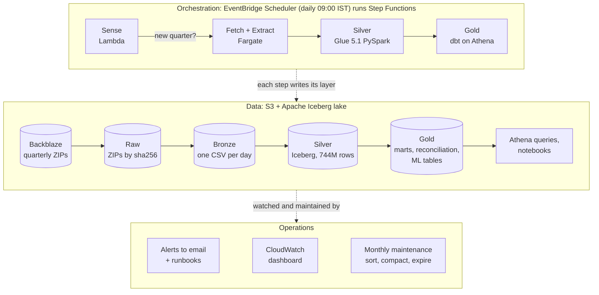
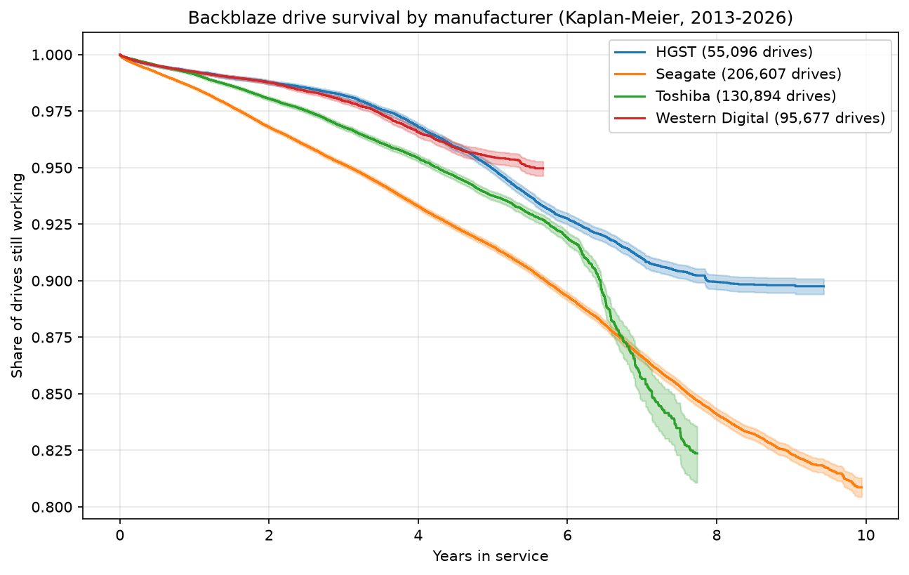
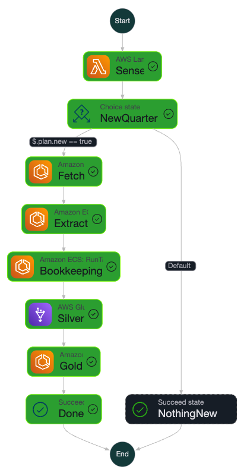
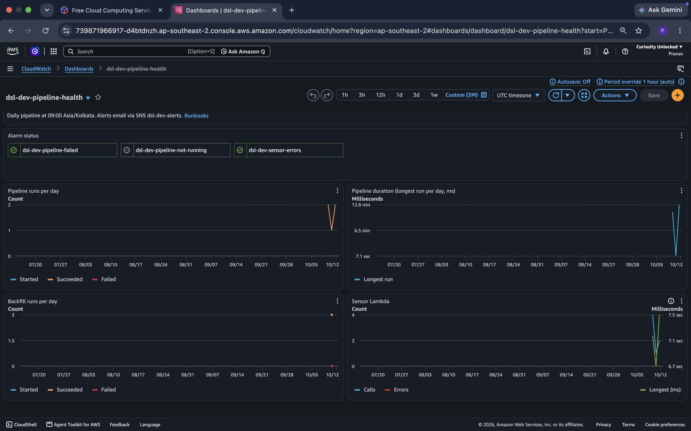

# Backblaze Drive Stats Data Platform

**A production-style batch data platform on AWS that turns 13 years of Backblaze hard drive telemetry (744 million drive-days) into tested, reconciled reliability marts and point-in-time-correct ML tables. It runs daily with no manual steps.**

### AWS services

<table>
<tr>
<td align="center" width="120"> <b>Glue 5.1</b></td>
<td align="center" width="120"> <b>Athena</b></td>
<td align="center" width="120"> <b>Step Functions</b></td>
<td align="center" width="120"> <b>Fargate</b></td>
<td align="center" width="120"> <b>S3</b></td>
<td align="center" width="120"> <b>Lambda</b></td>
</tr>
</table>

### Data Engineering

<table>
<tr>
<td align="center" width="140"> <b>Apache Iceberg</b></td>
<td align="center" width="140"> <b>PySpark</b></td>
<td align="center" width="140"> <b>dbt</b></td>
<td align="center" width="140"> <b>Terraform</b></td>
<td align="center" width="140"> <b>Python</b></td>
<td align="center" width="140"> <b>Docker</b></td>
</tr>
</table>

## Key numbers

| | |
|---|---|
| History loaded | 13 years, 4,830 daily files, **744,290,059 rows**, 12 different source header layouts |
| Correctness | Recomputed **all 78 AFR figures** Backblaze has published: **74 match** within tolerance, 4 gaps investigated and documented |
| Idempotency | Full pipeline rerun produced an **identical gold fingerprint** |
| Spark tuning | Silver load for one quarter: **1,944 s → 502 s** (3.9x faster) by fixing repeated work from Spark laziness |
| Storage layout | Sorting and compaction: one-drive lookup **4,043 MB → 115 MB scanned**, table **30% smaller**; month partitions for recent data then cut quarterly reads **3x** at a measured cost to lookups ([details](docs/performance.md)) |
| Data quality | Versioned source contract, per-day verdicts, write-audit-publish, quarantine; a duplicated source file found and handled |
| ML-ready | 121.8M-row feature table with a 30-day failure label, **null (not 0) at the data horizon**, guarded by 4 leakage tests |
| Operations | Email alerts with runbooks, dashboard, monthly maintenance, every change through PR + CI |

## Architecture

Raw is immutable and the replay source; every stage processes an explicit list of days, so the 13-year backfill and a quarterly load use the same code path.

## The problem

A fictional cloud storage company buys hundreds of thousands of drives. Three teams need answers:

| Team | Question | Output |
|---|---|---|
| Procurement | Which models fail least per drive-year? | AFR by model and quarter, survival curves |
| Data center ops | How healthy is the fleet right now? | Daily fleet health with rolling 30-day AFR |
| Reliability / ML | Can SMART data predict failure 30 days out? | Point-in-time feature and label table |

The source behaves like a real vendor feed: quarterly ZIP drops, schema drift across 13 years, empty and duplicated files, model name variants.

## How it works

| Layer | Storage | What happens |
|---|---|---|
| Raw | S3, content-addressed by sha256 | Every ZIP archived byte for byte; republished files land beside the original |
| Bronze | S3, one gzip CSV per day | The day is the unit of work |
| Silver | Iceberg (Glue PySpark) | Parse by header name across 12 layouts, cast, quarantine bad rows, dedupe, judge each day against the contract, write on an audit branch, publish |
| Gold | Iceberg (dbt on Athena) | Dimensions, AFR marts, fleet health, reconciliation, ML tables; full rebuild with tests on every run |

**Orchestration.** A Lambda sensor checks for the next quarterly ZIP every day; Step Functions runs fetch, extract, silver and gold; a separate backfill state machine replays any list of quarters one at a time, with retries for Glue concurrency limits.

**Data quality.** `contracts/drive_stats_daily.v1.yaml` holds the rules: required columns, date formats, quarantine and conflict limits, a row-count baseline (median of the previous 7 days), and known source defects. Every day gets a verdict in `ops.silver_days` (ok, warn, partial, blocked) and silver is written to an Iceberg branch and published only after audits pass (write-audit-publish). Replays replace exactly the listed days ([ADR 0002](docs/adr/0002-silver-replace-days.md)). The drift policy (new SMART column added, new non-SMART column blocked until the contract is updated) is proven by an automated [drift drill](docs/drift-drill.md).

**Reconciliation.** Backblaze publishes AFR figures in blog posts. Matching them required reverse-engineering their inclusion rules, which changed by era: excluding boot drives (under 1 TB) and small-population models with thresholds of 45, 60, and then 100 drives plus 10,000 drive-days. Their own posts disagree with each other by up to 0.06, which set the tolerance. Details and wrong turns: [docs/reconciliation.md](docs/reconciliation.md).

**ML tables.** `surv_drive` (one row per drive for survival analysis), `fct_drive_failure` (SMART state at failure and its 7/30-day change), and `feat_drive_day` (daily features plus `label_fail_30d`). Features look only backwards; the label is null where the 30-day window runs past the data. Leakage tests recompute features from silver and check labels against an independent table: [docs/ml-tables.md](docs/ml-tables.md).

**Operations.** SNS email alerts for a failed pipeline, a pipeline that stopped running, sensor errors and any failed Glue job (including inside the backfill), each linking to a [runbook](docs/runbooks/README.md). A CloudWatch dashboard shows runs, durations and alarm state. A monthly Glue job keeps silver sorted and compacted and expires old snapshots.

**CI/CD.** Every change goes through a pull request: ruff and 85 pytest tests, Terraform fmt/validate/plan. On merge, CI applies Terraform, deploys the Glue code and builds the Docker image with immutable tags. All infrastructure is Terraform, except the alert email subscription, which is added by hand so the address stays out of this public repo; IAM is least-privilege per component.

## Findings

- **Survival differs by manufacturer** (Kaplan-Meier, censored drives handled correctly): HGST holds about 90% at 9 years, Toshiba wears out sharply after about 6 years, Seagate declines steadily. Manufacturer curves mix many models, so this is a starting point, not a verdict.
- **Most failures give a warning, but not all.** On their last day, 59% to 78% of failed hard drives (by manufacturer) showed at least one of SMART 5, 187, 188, 197 or 198 above zero; the rest failed silently, which caps what SMART-based prediction can achieve.
- **"Failed drives never come back" is false.** 3.6% of failed serials reappear. Using power-on hours as an odometer: 93% are the same physical drive (late reporting or returned to service), 7% are a different drive reusing the serial. Death is defined as the first failure.
- **One source file is a copy of the next day's.** 2022-12-10 matches 2022-12-11 on 235,615 of 235,623 rows; power-on hours jump two days' worth. The contract now carries known source defects, and the day is skipped with a warning instead of loaded as fake data.

## Decisions and trade-offs

| Decision | Why | Trade-off |
|---|---|---|
| Step Functions, not Airflow | Workload is daily and tiny; no always-on scheduler to pay for | Less familiar UI than Airflow |
| Iceberg with replace-days on a WAP branch ([ADR 0002](docs/adr/0002-silver-replace-days.md)) | The source is authoritative per day, so replacing days is simpler than MERGE and reruns are idempotent | Two commits per load |
| Sort silver by serial_number, not by model as first planned | Benchmarks showed model filters were already cheap and serial lookups read 4 GB | Date-filtered queries read more (3 MB to 63 MB); month partitions for 2025+ cut that to 20 MB but raised one-drive lookups to 430 MB, because a month fits in one or two files. Kept months: quarterly reads are the everyday workload |
| dbt runs inside the fetcher image | One image, one build pipeline | Image carries dbt even for fetch tasks |
| Feature table in dbt on Athena, not Glue | Fits at a one-year scope; reviewable SQL and tests | Full-history features would need incremental builds |
| CI with stored keys, OIDC deferred ([ADR 0001](docs/adr/0001-ci-aws-credentials.md)) | Faster start on a Free plan account | Long-lived credentials; OIDC is the next step |
| Dev only; prod deferred ([#81](https://github.com/PRANAV-ADITYA/backblaze-drive-stats-platform/issues/81)) | Cost | No promotion step yet |

Deep dives: [full design document (PDF)](docs/Backblaze_Drive_Stats_Design.pdf), [performance](docs/performance.md), [source profiling](docs/profiling-report.md), [pipeline](docs/pipeline.md), [reconciliation](docs/reconciliation.md), [ML tables](docs/ml-tables.md).

## Evidence

| Pipeline run (Step Functions) | Health dashboard |
|---|---|
|  |  |

Benchmarks: [before](docs/evidence/benchmark-before.md) and [after](docs/evidence/benchmark-after.md) the silver layout change.

## Repository layout

| Folder | Contents |
|---|---|
| contracts/ | Source data contract (versioned YAML) |
| fetcher/ | Sensor Lambda, fetch/extract and gold (dbt) tasks, Dockerfile |
| silver/ | Glue PySpark package: read, cast, dedupe, audit, publish |
| glue/ | Glue entry scripts (silver load, maintenance) |
| dbt/ | Models (dims, facts, marts, reconciliation, ml), seeds, tests |
| infra/ | Terraform: bootstrap (IAM, applied locally), envs/dev (applied by CI) |
| analysis/ | Kaplan-Meier notebook, silver benchmark |
| docs/ | Design notes, ADRs, runbooks, evidence |
| tests/ | pytest unit tests |

## Known gaps and next steps

- Prod environment with artifact promotion and approval ([#81](https://github.com/PRANAV-ADITYA/backblaze-drive-stats-platform/issues/81)); drive location history as SCD2 ([#76](https://github.com/PRANAV-ADITYA/backblaze-drive-stats-platform/issues/76)).
- 2015 yearly AFR differs from Backblaze's published figure (2.47 vs about 2.78); not yet explained.
- The sensor handles quarterly ZIPs only (2013 to 2015 were published yearly; loaded by backfill).
- Glue time per quarter grows with the fleet (154 s in 2013 to 1,869 s in 2026).

## Data and license

Data: [Backblaze Hard Drive Data and Stats](https://www.backblaze.com/cloud-storage/resources/hard-drive-test-data), used with attribution. Backblaze's data may not be sold. This project is not affiliated with Backblaze.
